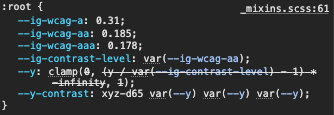

import CodeBlockHeader from '@/components/CodeBlockHeader';

# Palette Mixin

  After creating a palette map with your design system colors, you can include it using the palette mixin. This will generate CSS variables based on the map.

	<br/>
  <CodeBlockHeader title="CSS output"/>
	```css 
	:root {
	  --ig-primary-500: #f34e4e;
	  --ig-secondary-500: #fff6ea;
	  --ig-actions-500: #7bb9fa;
	  --ig-gray-500: #ebebeb;
	  --ig-black-500: #282828;
	}
	```
	<br/>

  When the palette is passed to the mixin, it first checks whether it was included inside a selector. This is handled by the custom [is-root()](https://www.infragistics.com/products/ignite-ui-angular/docs/sass/latest/utilities/#function-is-root) function. If the mixin isn't inside a selector, the CSS variables are declared at the `:root{:sass}` level.

  It then iterates through the palette map, processing each color group and variant with a custom mixin called `shade{:sass}`. The `shade{:sass}` mixin gathers the color group, variant and color of the passed map and creates new variables based on them. Which means that the names that we set in the map are what the variables are made with. 

  The generated variables follow this structure:

  ```css
  --ig-{color-type}-{color-variant}: {color-value};
  ```

  For example:

  ```css
  --ig-primary-500: #f34e4e;
  ```

  ## Contrast parameters

  In addition to the palette, the `palette{:sass}` mixin also accepts contrast-related parameters such as `$contrast` and `$contrast-level`:
  
  - `$contrast`: a boolean (true or false). Determines whether CSS variables for contrast color calculations are included with the palette. (By default it's set to `true{:js}`)

  - `$contrast-level`: sets the [WCAG](https://www.w3.org/TR/UNDERSTANDING-WCAG20/visual-audio-contrast-contrast.html) contrast level (A, AA, or AAA) used when calculating adaptive contrast colors via the `adaptive-contrast(){:bash}` function. (By default it's set to '**AA**')
  
  If you want to change the [WCAG](https://www.w3.org/TR/UNDERSTANDING-WCAG20/visual-audio-contrast-contrast.html) contrast level, you can use the `$contrast-level` parameter and pass one of the three levels (in lowercase): 'a', 'aa', or 'aaa'. For example, if you set the level to AAA ('aaa'), all of the contrast colors in this scope, which are calculated with the `adaptive-contrast(){:bash}` function, will be recalculated to meet the AAA requirement.

  {/*  */}

	```scss
    @include palette($my-palette, $contrast-level: 'aaa');
	```

  To learn more about the `adaptive-contrast(){:bash}` function, you can check out the [Adaptive contrast](adaptive-contrasts) section.