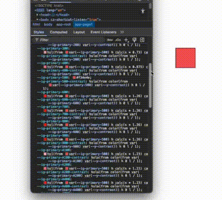

import RuntimeSample from '@/components/Samples/ColorsRuntime';

# Runtime changes

  As you already saw, all of the auto-generated color variants are based on the passed `500{:sass}` variant color for each color group.
  A very useful feature of these auto-generated colors is that, since they are calculated dynamically, they can also be updated at runtime.

  This means all color variants of a given type can be recalculated simply by updating the `500{:sass}` variant color.

  {/*  */}

<RuntimeSample/>